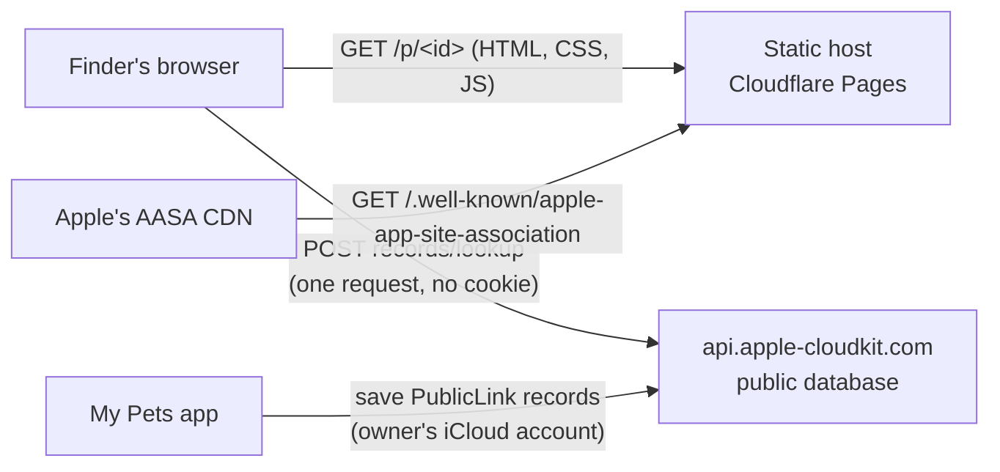

# My Pets public page: design

Status: proposal, 9 Nov 2026. A static site: one HTML page, one stylesheet and one script, on a free host.
Plan: `.claude/PRPs/plans/phase-8-static-page.plan.md` in `binary-bridges-co/my-pets-ios` (umbrella § "Amendment round 2").
Contract: Spec §15 revision 2 (`Spec/envelope-v1.md` §15.7–§15.12) and `Spec/vectors/public-card.json` version 2, copied here with a pinned commit (`test/spec/SPEC_SOURCE`). Every place in the code that depends on a §15 r2 detail not yet merged in the iOS repo is marked `// SPEC15R2:`; §12 lists them.

Reused from the archived Kotlin server (`binary-bridges-co/my-pets-server`): the page design, its states and strings in English and Spanish, the stylesheet, the fragment reader and the cofactorless Ed25519 verifier on vendored `@noble/ed25519`, and the server's DESIGN §7 (states, budget), §8 (headers), §10 (app links) and §12 (threats T5, T6, T8). Everything server-only (controllers, Postgres, rate limits, Traefik) is gone.

## 1. Goals and non-goals

Goals:
- `https://pets.binarybridges.co/p/<id>` shows exactly what the owner published, read from the CloudKit public database of `iCloud.co.binarybridges.pets` in the visitor's browser.
- Nothing runs on a machine Binary Bridges pays for (owner, 5 Nov 2026).
- Nothing about visitors is kept by us: no analytics, no storage, no request other than the one lookup.
- The site serves `/.well-known/apple-app-site-association`, so My Pets opens from the link.
- The same `dist/` deploys to Cloudflare Pages (chosen), GitHub Pages or Netlify.

Non-goals: writes of any kind (the page holds a read-only token and the World role can only read), scan counters, maps, Apple's CloudKit JS script, fonts, service workers.

## 2. Architecture



`dist/` after `npm run build`:

| Path | What |
|---|---|
| `p/index.html` | The page for every `/p/*` (a 200 rewrite). Its static body is state A, in English and Spanish |
| `index.html` | The site's home: one line on what the site is |
| `404.html` | "This isn't a My Pets tag link." for anything else |
| `assets/page.<hash>.js`, `assets/page.<hash>.css` | The only script and stylesheet, content-hashed |
| `.well-known/apple-app-site-association` | App links (§9) |
| `_headers`, `_redirects` | Cloudflare Pages and Netlify configuration (§8, §10) |
| `.nojekyll` | So GitHub Pages serves the dot folder |

Source: `src/` (TypeScript: `page.ts` entry, `cloudkit.ts`, `reader.ts`, `card.ts`, `chipCard` rules, `fragment.ts`, `ed25519.ts`, `jcs.ts`, `jpeg.ts`, `render.ts`, `text.ts`, `where.ts`, `strings/{en,es}.json`), `vendor/` (pinned `@noble/ed25519`), `config/` (container, environment, token per deploy), `scripts/` (build, vendor and Spec checks, budget, headers check, local preview).

## 3. CloudKit Web Services (phase 0)

The plan's phase 0 is a spike against a real container. The Developer Program membership has expired, so it waits for the renewal at the closed beta (Q-R2-3). Until then every answer below comes from Apple's documentation, and the page is built and tested against responses shaped from it (`test/fixtures/`). Each *to verify* item is checked first thing after renewal (`docs/RUNBOOK.md` step 1), and the fixtures are replaced by recorded ones.

Sources, read 5–9 Nov 2026: CloudKit Web Services Reference (archive, last updated 2016-06-13): "Composing Web Service Requests", "Fetching Records by Record Name", "Types and Dictionaries", "Modifying Records" (error dictionary), "Error Codes"; developer.apple.com/documentation/cloudkit/obtaining-an-api-token-for-an-icloud-container; developer.apple.com/documentation/cloudkitjs.

| # | Question | From the documentation | Status |
|---|---|---|---|
| C1 | The request | `POST https://api.apple-cloudkit.com/database/1/<container>/<environment>/public/records/lookup?ckAPIToken=<token>`, body `{"records": [{"recordName": …}, …]}` (up to 200 names). `ckAPIToken` is required; `ckWebAuthToken` is optional and only for a signed-in user; a token and a server-to-server key can't be combined | Documented |
| C2 | The answer | `{"records": [ … ]}`, one entry per name asked for: a record dictionary (`recordName`, `recordType`, `recordChangeTag`, `fields`, `created`, `modified`, `deleted`) or a fetch error dictionary (`recordName`, `reason`, `serverErrorCode`, `retryAfter`, `uuid`). A field is `{value, type}`; Bytes are "a Base64-encoded string", Int64 a number | Documented. *To verify:* that a missing name is an entry with `serverErrorCode` `NOT_FOUND`; the exact `type` strings (`BYTES`, `INT64`, as CloudKit JS and the vectors use); the Base64 alphabet and padding (the page accepts standard Base64, with or without padding) |
| C3 | Request-level errors | `{uuid, serverErrorCode, reason, retryAfter?, redirectURL?}` with HTTP statuses: `ACCESS_DENIED` 403, `AUTHENTICATION_FAILED` 401, `AUTHENTICATION_REQUIRED` 421, `BAD_REQUEST` 400, `NOT_FOUND` 404, `QUOTA_EXCEEDED` 413, `THROTTLED` 429, `TRY_AGAIN_LATER` 503, `INTERNAL_ERROR` 500, `ZONE_NOT_FOUND` 404 and others | Documented. The page treats every one of them as "can't reach the card" (state E or H) and never retries |
| C4 | **Can a browser call it (CORS)?** | The documentation never says "CORS" or "browser". It says an API token is for "a website or an embedded web view", and the token's **Allowed Origins** setting ("Restrict the domains that can access your app's container using CloudKit web services") only means something for browser calls, which send `Origin`. CloudKit JS, Apple's own browser library, calls this same host from the page's origin with `XMLHttpRequest`, which a browser allows only when the answer carries CORS headers | **Inferred yes; to verify live.** The page sends a CORS-simple request (`POST` with a `text/plain;charset=UTF-8` body, the content type of Apple's own example, no custom header), so no preflight should be needed. If the live check fails: owner question Q-R2-4 |
| C5 | Rate limits | A throttle (`THROTTLED`, `retryAfter`), no published per-request price | Documented; the current limits are *to verify* in the Console's Usage page |
| C6 | What Apple logs | The Console offers developers "server log data" | *To verify:* what the Console shows for anonymous web lookups (R2.1 A6) |
| C7 | CloudKit JS | Not deprecated, not developed. Not used: it would be a third-party script (CSP, budget, privacy) | Settled (R2.1 A7) |

Everything CloudKit-specific sits behind one function, `lookup()` in `src/cloudkit.ts`: names in, records or a failure out. The reader (§4) works on `{name, fields: {key: {type, bytes | value}}}` and doesn't know CloudKit's wire form.

## 4. The reader (Spec §15.8 r2)

The page asks for `<id>` and `<id>.1` … `<id>.7` in one lookup and, for each record found, ignores it with the first failing code:
1. **Record** (`record.invalid`): its name is one of the eight asked for (exact upper case); exactly the fields `v` (Int64 `1`), `key` (Bytes 32), `body` (Bytes 1–4096), `sig` (Bytes 64) and optionally `photo` (Bytes 1–102400); an operation (a body that is a JSON object with an `op` member) has no `photo`.
2. **Signature** (§15.4): key rules (`request.malformed`), the key's link id is the URL's (`key.mismatch`), Ed25519 over the exact body under the tag its shape calls for (`sig.invalid`), canonical JCS (`card.notCanonical`), the card table or operation shape (`card.unsupportedVersion`, `card.invalid`); an operation's `id` is the URL's id.
3. **Photo** (`photo.mismatch`, `photo.invalid`): the bytes are present when the card names one, absent when it doesn't, hash to `photo.sha256` and pass the JPEG rule with `w` and `h`. A failure drops the photo, never the card.
4. **Age**: a card or an `unpublish` whose `published` is more than 395 days before the visitor's clock is `published.stale` (exactly 395 days is accepted). A `deactivate` never ages out.

Then: any accepted `deactivate` → **deactivated**; else the greatest `published` decides (a tie goes to the operation, then to the lower name): a card → **published**, an `unpublish` → **unpublished**; nothing accepted → **not published**. The same code runs every `reader` case of `public-card.json` in Node.

## 5. States

| # | State | When | What the visitor sees |
|---|---|---|---|
| A | Bare | No JavaScript; or not published or unpublished, with no fragment or a link-only one | "This tag's details are on its NFC chip. Hold your phone to the tag, or call the number engraved on its back." |
| B | Published | The reader selected a card without `lost` | "Hi, I'm Luna", the breed line, the photo (from the record's bytes as a `blob:` URL), Call / Message, Important rows, My vet, footer "Published by my family · updated 2 min ago." |
| C | Published and lost | The selected card has `lost` | B plus the lost band, the Last seen row and Send where I am |
| D | Deactivated | An accepted `deactivate` | "This tag is no longer active." The fragment is ignored |
| E | The tag's copy | Not published (or the lookup failed) and a fragment that verifies | The copy, "Details on the tag · written 2 Oct. My Pets hasn't checked who wrote them." No lost band, never "Published by" |
| F | Refused fragment | Not published (or the lookup failed) and a fragment that fails | "These details don't match this tag's link", then A's text; nothing from the fragment |
| G | Not a tag link | The path isn't `/p/<link id>` | "This isn't a My Pets tag link." |
| H | Can't reach the card | The lookup failed (offline, timeout, CloudKit error, an answer that doesn't parse) and no fragment | "We can't show this card right now. Call the number engraved on the tag." No retry |
| — | Published + fragment | Both | B or C: a published card always wins |

Every state's footer carries the privacy line (owner Q-R2-2): "My Pets doesn't know when the tag is scanned. Like any website, the page's host and Apple's iCloud see the visitor's internet address."

Times: "updated N min ago" is the selected card's signed `published` against the visitor's clock; a clock behind it says "updated today". `since` and `lastSeen.at` are shown in the offset they were written in, with "today" judged in that offset.

Language: English or Spanish from `navigator.languages` (the first entry whose primary subtag is `en` or `es`; English otherwise). No cookie, no `Accept-Language` dependence. Without JavaScript, state A shows both languages, each marked with its `lang`.

## 6. What the script does (and only this)

1. Parses the id from the path (§15.2); a bad one is state G.
2. Sends **one** request (C1): `credentials: 'omit'`, `referrerPolicy: 'no-referrer'`, `cache: 'no-store'`, a 10 s `AbortSignal.timeout` where the browser has it. The fragment never leaves the page.
3. Runs the reader (§4) and renders B, C or D, or falls back to the fragment (E, F) or to A or H.
4. Send where I am (state C): one location fix on tap, built into an `sms:` message the finder opens and sends; nothing is sent anywhere by the page.
5. Nothing else: no storage (cookies, `localStorage`, `sessionStorage`, IndexedDB), no service worker, no prefetch, no timers beyond the request's timeout, no `innerHTML` (Trusted Types are enforced).

Every node is built with `createElement` and `textContent`; the only links are the page's own `tel:` and `sms:` for numbers that pass the digits check.

## 7. Budget (gzipped unless noted)

| Item | Budget |
|---|---|
| HTML | ≤ 4 KB |
| CSS | ≤ 6 KB |
| JS (Ed25519, JCS, reader, render, both languages) | ≤ 20 KB |
| CloudKit answer | ≤ 6 KB without a photo; the photo ≤ 100 KB |
| Requests for a published card | 4: HTML, CSS, JS, the lookup |
| Layout | 320 to 1920 px with no sideways scroll |

`scripts/check-budget.mjs` fails CI over any of the first three.

## 8. Headers (`_headers`)

On every response:

```
Strict-Transport-Security: max-age=31536000; includeSubDomains
X-Content-Type-Options: nosniff
Referrer-Policy: no-referrer
Cross-Origin-Opener-Policy: same-origin
Cross-Origin-Resource-Policy: same-origin
X-Frame-Options: DENY
X-Robots-Tag: noindex, nofollow, noarchive
Permissions-Policy: geolocation=(self), camera=(), microphone=(), payment=(), usb=(), interest-cohort=()
```

HTML:

```
Content-Security-Policy: default-src 'none'; script-src 'self'; style-src 'self'; img-src 'self' blob:;
  connect-src https://api.apple-cloudkit.com; font-src 'none'; form-action 'none'; frame-ancestors 'none';
  base-uri 'none'; object-src 'none'; manifest-src 'none'; require-trusted-types-for 'script'; trusted-types 'none'
Cache-Control: no-cache
```

`connect-src` names the CloudKit endpoint and nothing else; `img-src blob:` is for the photo built from the record's bytes. `assets/*` get `Cache-Control: public, max-age=31536000, immutable`. The AASA file gets `Content-Type: application/json` and `Cache-Control: max-age=3600`. `scripts/check-headers.mjs` checks all of it against any base URL: the local preview in CI, the Pages preview and production at go-live.

## 9. App links

`/.well-known/apple-app-site-association`, served with `Content-Type: application/json`, status 200, no redirect:

```json
{"applinks":{"details":[{"appIDs":["9JB56TN367.co.binarybridges.pets"],"components":[{"/":"/p/*","comment":"collar tag and lost page"}]}]}}
```

Team ID `9JB56TN367` (Binary Bridges SAS), bundle id `co.binarybridges.pets` (owner, 4 Nov 2026). Apple's CDN fetches this file, not visitors' phones, so it reveals nothing about scans. `assetlinks.json` waits for an Android package and certificate.

## 10. Hosting

Cloudflare Pages on the free plan (owner, 5 Nov 2026), deployed from `dist/`. `_redirects` holds the one rewrite, `/p/*  /p/index.html  200`; Pages serves `404.html` for anything else. Web Analytics stays **off** (it injects a script). The custom domain `pets.binarybridges.co` is a CNAME to the project's `pages.dev` name at Namecheap; no nameserver move. Step by step: `docs/RUNBOOK.md`.

Portability: `npm run build -- --host=github-pages` writes the same files plus a `<meta>` CSP (without `frame-ancestors`, which a meta tag can't carry) and a `404.html` that is the page itself, since GitHub Pages has neither headers nor rewrites. Netlify reads the same `_headers` and `_redirects`.

`npm run preview` serves `dist/` locally with the same `_headers` and `_redirects` rules, and the browser tests and the header check run against it.

## 11. Threats

| # | Threat | Mitigation | Rest risk |
|---|---|---|---|
| T5 | XSS through card or fragment text | Text-only rendering (`textContent`), strict CSP with no inline script or style, Trusted Types, tests with hostile names | Low |
| T6 | Phishing through a crafted fragment on a real link | Fragment shown only when its key hashes to the id and its signature verifies; else state F; never called "published" | Low |
| T8 | Visitor tracking by us | No analytics, storage or cookies; the one lookup with `credentials: 'omit'` and no referrer; no third-party asset; the host's analytics off; tests record every request | The host and Apple see the visitor's address and the link id, stated on the page (§5) |
| T16 | A forged or replayed record | §4: only the tag key's signature is accepted; the newest signed state wins; deactivate is final; 395-day age limit | A squatter on `<id>` before the reservation: the page shows the fragment or A (Spec §15.11) |
| T17 | A hostile photo | Never decoded by us before the marker walk; hash and JPEG rule first; shown from a `blob:` URL only | The browser's own decoder |
| T18 | The token is abused | It reads only what is public by link; the World role can't write; Allowed Origins stops other sites embedding it | Scripts can read records by name, as anyone can |
| T19 | Supply chain | No runtime dependency but the vendored, hash-pinned `@noble/ed25519`; dev tools pinned exactly; actions pinned by SHA | Standard |

## 12. Dependencies on Spec §15 r2

Until `public-card.json` version 2 is merged in the iOS repo and copied here, the code follows the round-2 plan (R2.3) and the 8b2 draft, and marks each spot with `// SPEC15R2:`:
- the record's field table and the eight names (§15.7);
- how a body's shape picks its tag (an object with `op`);
- an operation beside a `photo` is `record.invalid`; photo bytes beside a card without `photo` are `photo.mismatch`;
- the 395-day rule and its edge, and a `deactivate` that never ages out;
- the selection: deactivate first, then the newest, a tie to the operation and then the lower name;
- "unpublished" falls back to the fragment like "not published".

The page's reader passes every `reader` case of the 8b2 draft (`public-card.json` version 2, 41 cases, run locally against the unmerged file); the pinned copy moves to version 2 when 8b2 merges.

## 13. Tests

- **Unit** (`npm test`, Node's test runner on esbuild bundles): the Spec vectors (`test/unit/vectors.test.ts`), the reader on synthetic records (`reader.test.ts`), `cloudkit.ts` on answers shaped from the reference (`cloudkit.test.ts`), dates and languages (`text.test.ts`), and that the committed browser fixtures are current (`fixtures.test.ts`).
- **Browser** (`npm run test:e2e`, Playwright on Chromium, Firefox and WebKit): the built `dist/` served by `scripts/preview.mjs` with the host's `_headers` and `_redirects`. CloudKit is answered from `test/fixtures/scenarios.json` (generated by `npm run fixtures` from `test/support/scenarios.ts`, synthetic keys); every other request that leaves the preview is aborted. Every test fails on a CSP violation.
